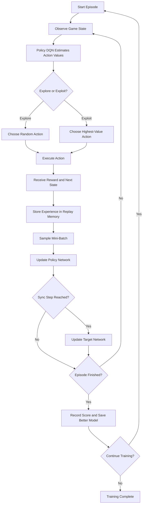
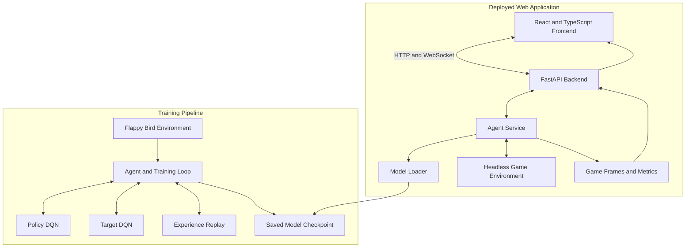
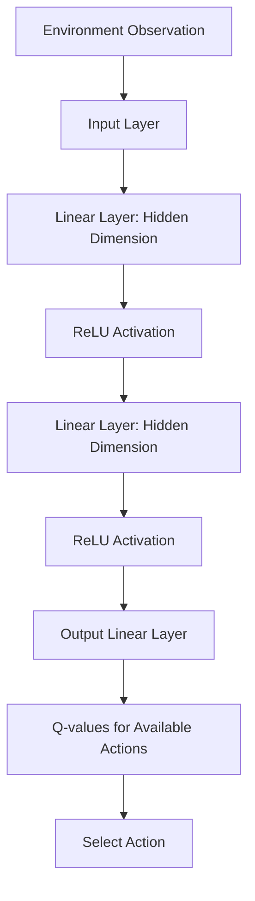

# Flappy Bird AI — Deep Q-Network (DQN)

An AI agent that learns to play Flappy Bird using **Deep Reinforcement Learning**. The project combines a Deep Q-Network (DQN), experience replay, and a target network with a web-based dashboard for watching the trained agent play and monitoring its performance.

**Live Demo:** https://flappy-bird-dqn-vo2r.onrender.com  
**Repository:** https://github.com/arpbiswas04-coder/FlappyBird-DQN

---

## Table of Contents

- [Overview](#overview)
- [Project Highlights](#project-highlights)
- [Training Results](#training-results)
- [How It Works](#how-it-works)
- [System Architecture](#system-architecture)
- [DQN Architecture](#dqn-architecture)
- [Reinforcement Learning Concepts](#reinforcement-learning-concepts)
- [Training Workflow](#training-workflow)
- [Technology Stack](#technology-stack)
- [Project Structure](#project-structure)
- [Installation and Setup](#installation-and-setup)
- [Training the Agent](#training-the-agent)
- [Running the Web Dashboard](#running-the-web-dashboard)
- [API Endpoints](#api-endpoints)
- [Model Checkpoint and Deployment](#model-checkpoint-and-deployment)
- [Configuration](#configuration)
- [Testing](#testing)
- [Troubleshooting](#troubleshooting)
- [Future Improvements](#future-improvements)
- [Acknowledgements and Attribution](#acknowledgements-and-attribution)
- [License](#license)

---

## Overview

Flappy Bird is a simple-looking game that requires precise timing. The bird must flap to stay airborne, navigate through gaps between pipes, and avoid collisions.

Instead of manually programming every movement, this project uses **reinforcement learning** to teach an AI agent how to select actions based on its current observation of the game.

The agent interacts with the environment, receives rewards, learns from past experiences, and gradually improves its decision-making policy.

The project includes two major parts:

1. **Reinforcement learning system:** Trains a DQN agent using the Flappy Bird Gymnasium environment.
2. **Web-based demonstration:** Serves the saved model through a Python backend and provides an interactive dashboard for watching gameplay and viewing performance information.

The deployed website is designed to run inference with a saved checkpoint. Training is performed separately using the training script.

## Project Highlights

- Deep Q-Network implemented with PyTorch.
- Reinforcement learning through interaction with the Flappy Bird environment.
- Experience replay using a bounded FIFO memory buffer.
- Separate policy and target networks for more stable learning.
- Epsilon-greedy exploration and exploitation.
- Configurable hyperparameters through YAML.
- Automatic saving of improved checkpoints during training.
- React-based dashboard for live gameplay and metrics.
- FastAPI backend with REST endpoints and WebSocket communication.
- Deployment configuration for Render.
- Automatic checkpoint download and ZIP extraction for cloud deployment.

## Training Results

| Metric | Result |
|---|---|
| Training episodes completed | 30,000 |
| Best reported score | 63.5 |
| Learning algorithm | Deep Q-Network (DQN) |
| Deep learning framework | PyTorch |
| Environment | Flappy Bird Gymnasium |
| Web hosting | Render |

The model was trained for 30,000 episodes and achieved a best reported score of **63.5**.

The best score represents the highest score observed during training, not the average score across all episodes. Results can vary between training runs because of exploration, environment randomness, and hyperparameter settings.

---

## How It Works

The agent learns through repeated interaction with the game.

At each time step:

1. The environment provides an observation describing the current game state.
2. The neural network estimates the expected value of the available actions.
3. The agent chooses an action, either exploring or exploiting what it has learned.
4. The environment advances and returns the next observation, reward, and termination information.
5. During training, the transition is stored in replay memory.
6. A random mini-batch of past experiences is used to update the policy network.
7. The target network is periodically synchronized with the policy network.
8. At the end of an episode, the score is recorded and the checkpoint is updated when the episode improves the best reward.

Over many episodes, the agent learns which actions tend to produce higher cumulative rewards.

### High-level learning flow



---

## System Architecture

The project has a training pipeline and a separate web-serving pipeline.

### 1. Training pipeline

The training script interacts with the game environment, updates the neural network, and saves model weights.

### 2. Web application pipeline

The web application loads the trained checkpoint, runs the agent in a headless game environment, and streams game frames and metrics to the frontend.



The training pipeline creates or improves the model. The web pipeline loads the saved weights and uses them to select actions during gameplay.

The web application does not automatically resume the original training process simply because someone opens the website.

---

## DQN Architecture

The Deep Q-Network estimates the expected return associated with each available action.

The network implemented in `dqn.py` is a fully connected feed-forward neural network.

Its general structure is:



### Network layers

| Component | Purpose |
|---|---|
| Input layer | Accepts the observation vector from the environment |
| First fully connected layer | Learns combinations of input features |
| ReLU activation | Introduces non-linearity |
| Second fully connected layer | Learns higher-level feature combinations |
| ReLU activation | Adds another non-linear transformation |
| Output layer | Produces one Q-value for each available action |

The network uses a hidden dimension of 256 in the configured deployment model.

The output layer has two action values corresponding to the environment's two possible actions. The agent selects the action with the highest estimated Q-value when exploiting its learned policy.

The exact input dimensionality is determined by the environment and must match the dimensions used to create the saved checkpoint.

### Policy network

The policy network is the network that selects actions and is updated during training.

### Target network

The target network provides a more stable estimate for the learning target. Its weights are periodically synchronized with the policy network rather than being updated directly at every optimization step.

Using a target network helps reduce instability caused by continuously changing learning targets.

---

## Reinforcement Learning Concepts

### 1. Agent and environment

The **agent** is the DQN-controlled bird. The **environment** is the Flappy Bird game provided by Gymnasium and `flappy-bird-gymnasium`.

The agent observes the environment and chooses an action. The environment then returns the next observation, reward, and episode status.

### 2. State or observation

The observation is a numerical representation of the game situation. The neural network uses this vector as input to estimate action values.

The model must receive observations with the same structure and dimensions used during training.

### 3. Actions

The environment provides two discrete actions:

- `0`: Do not flap.
- `1`: Flap.

The policy chooses between these actions based on its current action-value estimates.

### 4. Reward

The reward is feedback from the environment. It indicates the immediate outcome of an action and helps the agent learn which sequences of decisions are more successful.

The episode score accumulates the rewards received throughout an episode, subject to the environment's reward design and episode termination rules.

### 5. Q-learning

A Q-value estimates the expected discounted cumulative reward associated with taking a particular action in a state and following the policy afterward.

The DQN approximates these values using a neural network rather than maintaining a separate table for every state-action pair.

### 6. Experience replay

Each experience contains:

- Current state
- Selected action
- Next state
- Reward
- Termination information

The replay buffer stores recent experiences in a bounded FIFO queue. During training, random mini-batches are sampled from this memory.

This reduces reliance on only the most recent transitions and allows the agent to learn from a broader collection of experiences.

### 7. Epsilon-greedy exploration

The agent balances exploration and exploitation using epsilon-greedy action selection.

- **Exploration:** Select a random action to discover different outcomes.
- **Exploitation:** Select the action with the highest predicted Q-value.

Epsilon decreases over training until it reaches the configured minimum, allowing the agent to rely increasingly on its learned policy.

### 8. Bellman target

The target value used by the implementation follows the standard one-step DQN update:

\[
y = r + \gamma(1-d)\max_{a'} Q_{\text{target}}(s',a')
\]

Where:

- \(y\) is the learning target.
- \(r\) is the immediate reward.
- \(\gamma\) is the discount factor.
- \(d\) indicates whether the transition is terminal.
- \(s'\) is the next state.
- \(Q_{\text{target}}\) is the target network.

The policy network predicts the Q-value for the action actually taken. The difference between its prediction and the target is used to calculate the loss, which is minimized through gradient descent.

The implementation uses mean squared error loss and the Adam optimizer.

---

## Training Workflow

The training logic is primarily implemented in `agent.py`.

### Training stages

1. Read the selected hyperparameter configuration from `parameters.yaml`.
2. Create the Flappy Bird environment.
3. Initialize the policy and target networks.
4. Initialize replay memory, epsilon, and the optimizer.
5. Run episodes and choose actions using epsilon-greedy selection.
6. Store transitions and sample mini-batches.
7. Optimize the policy network.
8. Synchronize the target network at the configured interval.
9. Decay epsilon after each episode.
10. Save the model whenever a new best episode reward is achieved.

### Model saving

The training script saves the policy network's state dictionary to a checkpoint in the `runs/` directory. It also records improvements in a log file.

A checkpoint stores the learned model parameters. It does not, by itself, contain every detail needed to resume the exact original training run, such as optimizer state, replay memory, and all random-number generator states.

---

## Technology Stack

| Technology | Role |
|---|---|
| Python | Main programming language |
| PyTorch | Neural network, optimization, and inference |
| Gymnasium | Reinforcement learning environment interface |
| flappy-bird-gymnasium | Flappy Bird game environment |
| NumPy | Numerical operations and supporting data handling |
| PyYAML | Loading hyperparameter configurations |
| Pygame | Game rendering and headless game execution |
| FastAPI | Backend API and WebSocket server |
| Uvicorn | ASGI server for FastAPI |
| Pydantic | API request and response schemas |
| React | Frontend user interface |
| TypeScript | Typed frontend development |
| Vite | Frontend development server and production build |
| WebSockets | Streaming gameplay frames and live metrics |
| Render | Cloud hosting for the web application |

---

## Project Structure

```text
FlappyBird-DQN/
│
├── agent.py                  # Training loop and DQN optimization
├── dqn.py                    # Neural network architecture
├── experience_replay.py      # Experience replay buffer
├── game_flappy_bird.py       # Manual game interaction
├── parameters.yaml           # Training hyperparameters
│
├── requirements-web.txt      # Web application dependencies
├── build.sh                  # Deployment build script
├── render.yaml               # Render Blueprint configuration
├── .env.example              # Example environment configuration
├── .gitignore                # Excluded local and generated files
│
├── webapp/
│   ├── __init__.py
│   ├── main.py               # FastAPI application and routes
│   ├── agent_service.py      # Inference and live game service
│   ├── model_loader.py       # Checkpoint download and extraction
│   └── schemas.py            # API response schemas
│
├── frontend/
│   ├── src/                  # React and TypeScript source
│   ├── package.json
│   ├── package-lock.json
│   └── vite.config.ts
│
├── tests/
│   └── test_backend.py       # Backend and model-loader tests
│
└── runs/                     # Local checkpoints and training logs
```

The `runs/` directory is generated locally and is excluded from normal Git commits. The production model checkpoint is distributed separately as a release asset and downloaded when needed.

---

## Installation and Setup

### Prerequisites

Install the following before setting up the project:

- Python 3.10 or another version supported by the repository's dependency configuration.
- Git.
- Node.js and npm.
- A terminal such as PowerShell, Command Prompt, or a Unix shell.

A CUDA-compatible GPU is helpful for training, but CPU execution is possible. GPU support depends on installing a compatible PyTorch build and the required NVIDIA drivers.

### Step 1: Clone the repository

```bash
git clone https://github.com/arpbiswas04-coder/FlappyBird-DQN.git
cd FlappyBird-DQN
```

### Step 2: Create a Python virtual environment

**Windows PowerShell**

```powershell
python -m venv .venv
.\.venv\Scripts\Activate.ps1
```

If PowerShell blocks activation, use the appropriate execution policy permitted on your system, or run the virtual environment's Python executable directly.

**Linux or macOS**

```bash
python3 -m venv .venv
source .venv/bin/activate
```

### Step 3: Install Python dependencies

For the web application, install the repository's web requirements:

```bash
python -m pip install --upgrade pip
pip install -r requirements-web.txt
```

Training also requires the packages imported by the training files. If the repository includes a dedicated training requirements file, install that as well. Otherwise, install the compatible dependencies used by the project, including PyTorch, Gymnasium, `flappy-bird-gymnasium`, PyYAML, NumPy, and Pygame.

For GPU training, install a PyTorch build compatible with your CUDA environment using the official PyTorch installation instructions.

### Step 4: Install frontend dependencies

```bash
cd frontend
npm ci
cd ..
```

`npm ci` installs the dependency versions recorded in `package-lock.json`.

### Step 5: Configure the model checkpoint

For local development, place the compatible trained checkpoint at the path expected by the inference service, normally:

```text
runs/flappybirdv0.pt
```

Create the directory if necessary:

```powershell
New-Item -ItemType Directory -Force runs
```

The checkpoint must match the expected network architecture and observation dimensions.

The deployed application can download the checkpoint using the `MODEL_URL` environment variable. Local development can use an existing checkpoint without downloading it again.

---

## Training the Agent

Training and web inference are separate workflows.

### Start training

From the repository root, activate the virtual environment and run:

```bash
python agent.py <parameter_set> --train
```

Replace `<parameter_set>` with a valid configuration key defined in `parameters.yaml`.

For example, if the configuration key is `default`:

```bash
python agent.py default --train
```

Use the key that actually exists in your configuration file.

The training loop continues until it is stopped manually or reaches its configured stopping behavior. It prints episode rewards and epsilon values and saves improved checkpoints.

### Run the trained agent locally

To load the saved model and render the game:

```bash
python agent.py <parameter_set>
```

This command uses the selected configuration and attempts to load the corresponding saved checkpoint.

### Manual game controls

The standalone `game_flappy_bird.py` script demonstrates manual interaction with the environment. In that script, the space bar triggers a flap.

### Important training note

Training can take considerable time. Running the training command again may resume from an existing checkpoint, depending on the training script's loading logic. Keep backups of useful checkpoints before experimenting with different configurations.

---

## Running the Web Dashboard

The web dashboard provides a visual interface for the trained agent.

### Step 1: Build the frontend

From the repository root:

```bash
cd frontend
npm ci
npm run build
cd ..
```

This creates the production frontend assets in `frontend/dist/`.

### Step 2: Start the backend

From the repository root:

```bash
python -m uvicorn webapp.main:app --host 127.0.0.1 --port 8000
```

The backend starts at:

```text
http://127.0.0.1:8000
```

If the production frontend has been built, the FastAPI application can serve it. Otherwise, start the Vite development server separately.

### Step 3: Start the frontend development server

Open a second terminal:

```bash
cd frontend
npm run dev
```

Open the local URL printed by Vite in your terminal.

The frontend development server proxies API and WebSocket requests to the backend according to the Vite configuration.

### Dashboard functionality

The dashboard is designed to provide:

- Live game visualization.
- Start, pause, resume, reset, and stop controls.
- Episode and reward information.
- Reward history and recent episode information.
- Model status.
- Streaming updates through WebSockets.

The exact metrics displayed depend on the state and information exposed by the running inference service.

---

## API Endpoints

The FastAPI backend exposes HTTP endpoints and a WebSocket connection for the frontend.

| Endpoint | Method | Purpose |
|---|---|---|
| `/api/health` | GET | Health check |
| `/api/model-status` | GET | Model loading status and related information |
| `/api/metrics/history` | GET | Available reward and episode history |
| `/ws/session` | WebSocket | Live game session, frames, controls, and metrics |
| `/docs` | GET | Interactive FastAPI API documentation |

### Health check

```http
GET /api/health
```

Used to check whether the backend responds.

### Model status

```http
GET /api/model-status
```

Reports whether the model is loaded and may include checkpoint details or an error message.

### Metrics history

```http
GET /api/metrics/history
```

Provides the history available from the running service.

### WebSocket session

```text
/ws/session
```

The frontend opens a WebSocket session to receive initialization data, game frames, and updates, and to send supported session-control messages.

The exact request and message schemas should be checked in `webapp/main.py`, `webapp/agent_service.py`, and `webapp/schemas.py`.

---

## Model Checkpoint and Deployment

The web service requires a compatible trained checkpoint.

### Local checkpoint

During local development, the model loader checks the expected checkpoint location. If a valid local file is already present, it can be used without making a network request.

### Cloud checkpoint

The production deployment uses a `MODEL_URL` environment variable to obtain the checkpoint when it is not already present.

The checkpoint is distributed as a ZIP release asset. The model loader downloads the archive, locates `flappybirdv0.pt`, validates it, and installs it at the expected checkpoint path.

The archive extraction logic is designed to avoid writing arbitrary archive paths directly to the filesystem and to clean up temporary files after failures.

### Render deployment

The repository includes a `render.yaml` Blueprint configuration and a `build.sh` script for deployment.

The general deployment process is:

1. Push the project to GitHub.
2. Publish the compatible checkpoint as a release asset.
3. Confirm the release download URL is accessible.
4. Create a Blueprint deployment in Render using `render.yaml`.
5. Configure `MODEL_URL` with the exact checkpoint asset URL.
6. Wait for the backend and frontend build to complete.
7. Verify the health endpoint and model status.
8. Open the deployed dashboard and test the gameplay controls.

**Live application:** https://flappy-bird-dqn-vo2r.onrender.com

The free Render instance may spin down after inactivity. Its first request after sleeping can take longer than a normal request.

### What happens when the model is missing?

The frontend may still load even if the checkpoint download or model initialization fails. A live website does not, by itself, prove that the AI model is ready.

Check `/api/model-status` and the Render service logs if the dashboard reports that the model could not be loaded.

---

## Configuration

Training hyperparameters are stored in `parameters.yaml`. The training agent reads the selected configuration when it initializes.

Important settings include:

| Parameter | Meaning |
|---|---|
| `alpha` | Learning rate used by the optimizer |
| `gamma` | Discount factor for future rewards |
| `epsilon_init` | Initial probability of random exploration |
| `epsilon_min` | Minimum exploration probability |
| `epsilon_decay` | Exploration decay factor |
| `replay_memory_size` | Maximum capacity of the replay buffer |
| `mini_batch_size` | Number of experiences sampled for an update |
| `reward_threshold` | Reward-based episode stopping threshold used by the training loop |
| `network_sync_rate` | Number of steps between target-network synchronizations |

The actual values are defined by the selected configuration in `parameters.yaml`. Consult that file before changing training behavior.

### Environment variables

| Variable | Purpose |
|---|---|
| `MODEL_URL` | URL used to download the model checkpoint when needed |
| `PORT` | Port supplied by the hosting environment |
| `SDL_VIDEODRIVER` | Configures Pygame rendering; `dummy` supports headless execution |

Use `.env.example` as a reference for configuration. Do not commit secrets, private credentials, or unnecessary local files.

---

## Testing

The project includes backend tests in `tests/test_backend.py`.

Run the backend test suite from the repository root:

```bash
python -m unittest tests/test_backend.py
```

The tests cover backend behavior and checkpoint-loading cases, including ZIP archive handling.

Build the frontend with:

```bash
cd frontend
npm ci
npm run build
```

For deployment verification, check:

1. The health endpoint responds successfully.
2. The model-status endpoint reports the expected state.
3. The root page loads.
4. Frontend assets load correctly.
5. The WebSocket session connects.
6. Game controls behave as expected.
7. The model produces valid action values.

Test results can vary after code changes, dependency updates, or environment changes. Run the tests again after modifying the project.

---

## Troubleshooting

### 1. Model checkpoint missing or could not load

**Possible causes:**

- The checkpoint is absent from the expected local path.
- `MODEL_URL` is missing or incorrect.
- The release asset returns HTTP 404.
- The ZIP archive does not contain `flappybirdv0.pt`.
- The checkpoint is corrupted or incompatible with the model architecture.

**What to check:**

1. Open the release asset URL directly.
2. Verify the `MODEL_URL` environment variable.
3. Inspect the backend logs.
4. Confirm that the checkpoint exists at the expected path.
5. Verify that the checkpoint matches the model architecture.

### 2. Frontend loads but the game does not start

Check the model status, browser console, backend logs, and WebSocket connection. The UI can load independently of successful model initialization.

### 3. WebSocket connection fails

Verify that the backend is running, the frontend proxy points to the correct backend, and the WebSocket route is accessible.

### 4. Training is slow

Neural network optimization and repeated environment interactions can be computationally expensive. Consider checking the device being used, replay-buffer settings, batch size, and the number of training steps.

### 5. Gymnasium observation warning

A warning about an observation falling outside the declared observation space may indicate a mismatch between the environment's returned observation and its declared bounds. Investigate the environment version and observation values if the warning persists. Do not assume it is harmless without testing its effect on the agent.

### 6. Render deployment takes time to respond

Free instances can sleep after periods of inactivity. Wait for the service to wake, then check the health and model-status endpoints.

---

## Future Improvements

Potential improvements include:

- Evaluate the trained agent over multiple independent episodes.
- Report average reward, median reward, and score variance alongside the best score.
- Save training curves and compare hyperparameter configurations.
- Add checkpoint versioning and reproducible training metadata.
- Track loss, episode duration, and exploration rate during training.
- Add automated evaluation scripts for saved models.
- Improve inference-service error reporting and model readiness checks.
- Add containerized local development for consistent setup.
- Add continuous integration for tests and frontend builds.
- Explore Double DQN or Dueling DQN and compare their performance against the baseline.
- Improve model download integrity checks with a trusted checksum.

These are possible extensions, not claims about features already implemented.

---


**Built as a hands-on project in deep reinforcement learning, neural networks, model inference, and full-stack deployment.**
